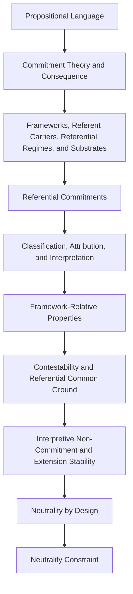

# SE Theory: Neutral Substrate

[](https://structural-explainability.github.io/se-theory-neutral-substrate/)
[](https://github.com/structural-explainability/se-theory-neutral-substrate)
[](./pyproject.toml)
[](./LICENSE)
[](https://doi.org/10.5281/zenodo.21694487)

[](https://github.com/structural-explainability/se-theory-neutral-substrate/actions/workflows/ci-lean.yml)
[](https://github.com/structural-explainability/se-theory-neutral-substrate/actions/workflows/ci-python-zensical.yml)
[](https://github.com/structural-explainability/se-theory-neutral-substrate/actions/workflows/deploy-zensical-lean.yml)
[](https://github.com/structural-explainability/se-theory-neutral-substrate/actions/workflows/links.yml)
[](https://github.com/structural-explainability/se-theory-neutral-substrate/security)

> Lean 4 formalization of the neutral structural substrate of
> Structural Explainability.

This repository formalizes neutrality conditions and the abstract
individuation, co-reference, and persistence interfaces composed by a
referential regime.
Substantive criteria and compatibility among those accounts
require separate justification.

The `NeutralityConstraint` is an explicit condition on realizations,
not a theorem derived from the abstract interfaces.
Its consequences require that constraint, Contestability, and Referential Common Ground.

Separately, under Referential Common Ground, restricting the foundational
layer to permitted classes is proved sufficient for semantic neutrality.
That result does not independently establish neutrality by design,
which requires a permitted design-time guarantee basis.

## Authority

Lean source files are authoritative for formal definitions, predicates, axioms,
theorems, proof obligations, and reference rules.

Reference artifacts under `reference/` and generated artifacts under
`data/` mirror the Lean public surface.
They do not define theory semantics independently of Lean.

The CI-Lean workflow builds the declared public Lean surface with
`lake build --wfail`,
failing on reported warnings, including `sorry`.
Successful compilation verifies formal declarations against their
stated assumptions; it does not establish the scientific adequacy
of those assumptions or interpretations.

## Import

Import the public theory surface:

```lean
import SE.NeutralSubstrate
```

## Lean Module Convention

Production Lean code uses the `SE.*` namespace.

- `SE.lean` is the repository production entry point.
- `SE/NeutralSubstrate.lean` is the public theory import surface.
- Production modules are organized under `SE/Logic/`, `SE/Framework/`,
  `SE/Referent/`, `SE/Substrate/`, and `SE/NeutralSubstrate/`.

Test Lean code uses the `SETest.*` namespace.

- `SETest.lean` is the repository test entry point.
- `SETest/NeutralSubstrate.lean` is the project test surface.
- Test modules live under `SETest/NeutralSubstrate/`.

`Spec.lean` defines a specification module.

## Theory Structure



## Reference Configuration

The theory-reference workflow is configured by:

```text
reference/theory-reference.toml
```

That file declares this repository's Lean public modules,
reference artifact layout, and export targets.
Public symbols are declared in the reference artifacts.

## Developer

Maintain:

- `formalization\source\se100-lean-basis.md` - from the paper
- `lakefile.toml`
- `lean-toolchain`
- `reference/theory-reference.toml` - hand-maintained configuration
- `reference/*.toml` - reference source artifacts
- Lean source and reference-rule (RR) traceability comments - hand-maintained theory source

### Clone and Open Project in VS Code

Open a machine terminal where you want the project
and open in VS Code:

```shell
git clone https://github.com/structural-explainability/se-theory-neutral-substrate

cd se-theory-neutral-substrate
code .
```

### Setup and Run

Use VS Code Menu:
View / Command Palette / `Developer: Reload Window` to refresh.

```shell
.\sit.ps1
.\rel.ps1

# inspect shared theory-reference command surface
uvx se-theory-reference-kit@latest --help
uvx se-theory-reference-kit@latest validate --help
uvx se-theory-reference-kit@latest scaffold --help
uvx se-theory-reference-kit@latest export --help
uvx se-theory-reference-kit@latest catalog --help
uvx se-theory-reference-kit@latest inspect --help

# validate reference artifacts against the declared Lean public surface
uvx se-theory-reference-kit@latest validate
uvx se-theory-reference-kit@latest validate --strict

# scaffold reference artifacts from Lean public declarations
uvx se-theory-reference-kit@latest scaffold
uvx se-theory-reference-kit@latest scaffold --dry-run
uvx se-theory-reference-kit@latest scaffold --overwrite

# regenerate or check generated JSON artifacts from reference TOML
uvx se-theory-reference-kit@latest export
uvx se-theory-reference-kit@latest export --check

# build or verify the generated reference catalog
uvx se-theory-reference-kit@latest catalog
uvx se-theory-reference-kit@latest catalog --check

# inspect resolved repository configuration and reference declarations
uvx se-theory-reference-kit@latest inspect

# validate SE manifest file
uvx se-manifest-schema validate-manifest --path SE_MANIFEST.toml --strict

# save progress
git add -A
git commit -m "update"
git push -u origin main
```

## Authority Manifest

[.accountability/surfaces.toml](./.accountability/surfaces.toml)

## Changelog

[CHANGELOG.md](./CHANGELOG.md)

## Citation

[CITATION.cff](./CITATION.cff)

## Documentation

[Documentation](https://structural-explainability.github.io/se-theory-neutral-substrate/) -
descriptive orientation

## Formal Semantics

[Lean](./SE.lean)

## License

[MIT](./LICENSE)

## Repository Manifest

[SE_MANIFEST.toml](./SE_MANIFEST.toml) -
repository semantic ownership/scope

## Reference

[reference/](./reference/) -
public-surface classification and traceability
