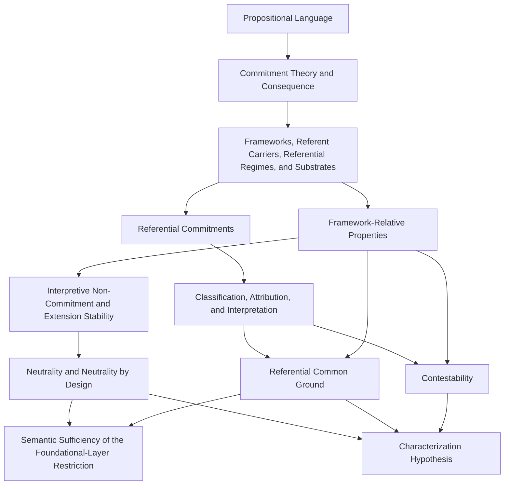

# SE Theory: Neutral Substrate

> Lean 4 formalization of the Neutral Substrate layer of
> Structural Explainability theory.

This repository formalizes the substrate conditions needed to remain compatible
with admissible interpretive frameworks without settling contested causal or
normative propositions at the foundational layer.

Lean source files under `SE/` are authoritative for formal definitions,
predicates, assumptions, theorems, and proof obligations.

- [Lean API Reference](https://structural-explainability.github.io/se-theory-neutral-substrate/lean/)
- [GitHub Repository](https://github.com/structural-explainability/se-theory-neutral-substrate)
- [Paper: Neutral Substrates (arXiv:2601.14271)](https://doi.org/10.48550/arXiv.2601.14271)
- [Reference registries](https://github.com/structural-explainability/se-theory-neutral-substrate/tree/main/reference)
  mapping the paper's stable `se100.*` tags to Lean declarations

## Neutral Substrate

The Neutral Substrate theory separates foundational commitments from
framework-relative interpretation.

This library states neutrality conditions in the abstract.
It does not certify any concrete realization: a realization must justify
its own referential fixing and framework compatibility.

## Theory Structure

The diagram summarizes the dependency structure of the Lean theory.
Arrows summarize module dependencies, not logical implication;
the sufficiency result is proved,
while the characterization remains an explicit hypothesis on realizations.

## Scope

Repository scope is defined in `SE_MANIFEST.toml`.

## Exclusions

Repository exclusions are defined in `SE_MANIFEST.toml`.

## Import

Downstream Lean projects should import the public surface:

`import SE.NeutralSubstrate`
