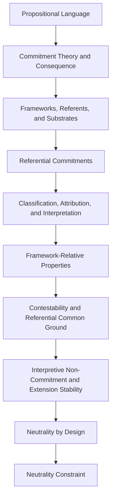

# SE Theory: Neutral Substrate

> Lean 4 formalization of the Neutral Substrate layer of
> Structural Explainability theory.

This repository formalizes the substrate conditions needed to remain compatible
with admissible interpretive frameworks without settling contested causal or
normative propositions at the foundational layer.

Lean source files under `SE/` are authoritative for formal definitions,
predicates, assumptions, theorems, and proof obligations.

- [Lean API Reference](https://structural-explainability.github.io/se-theory-neutral-substrate/lean/)
- [GitHub Repository](https://github.com/structural-explainability/se-theory-neutral-substrate)

## Neutral Substrate

The Neutral Substrate theory separates foundational commitments from
framework-relative interpretation.

The formalization distinguishes:

- propositions carried by a language
- commitments made by a substrate
- consequences of commitment theories
- admissible interpretive frameworks
- referential regimes and commitments
- causal and normative classification
- attributional and object-level propositions
- framework-relative variation and invariance
- interpretive non-commitment
- extension stability
- neutrality by design
- the neutrality constraint

Neutral Substrate theory defines
foundational **neutrality and admissibility conditions**
together with the **abstract referential interfaces**
required by a referential regime.

A **referential regime** composes distinct
individuation, co-reference, and persistence interfaces.
This repository defines those interfaces without
collapsing them into a common referential condition.

Substantive individuation, co-reference, and persistence theories remain
outside this repository, together with transformation theory,
identity-regime classification, operational identity, and integration theory.

Connections among the three abstract accounts require explicit justification.
Denotation and co-reference lifting are semantic obligations rather than
consequences of referent carriers or referential records.

Framework compatibility applies to complete commitment sets, not merely
to individual propositions.
The Lean theory expresses this condition, but a concrete realization
must justify its referential fixing and
establish compatibility of its resulting commitments with every
admissible framework.
Supplying the abstract referential interfaces does not discharge that obligation.

Under Referential Common Ground, restricting foundational commitments to
referential commitments and permitted attribution propositions is proved
sufficient for extension stability and neutrality.

This result does not establish neutrality by design.
The full `NeutralityConstraint` is an explicit condition
that a realization must satisfy;
the theorems in `Constraint.lean`
derive consequences under that condition.

## Theory Structure

## Scope

Repository scope is defined in `SE_MANIFEST.toml`.

## Exclusions

Repository exclusions are defined in `SE_MANIFEST.toml`.

## Import

Downstream Lean projects should import the public surface:

`import SE.NeutralSubstrate`
